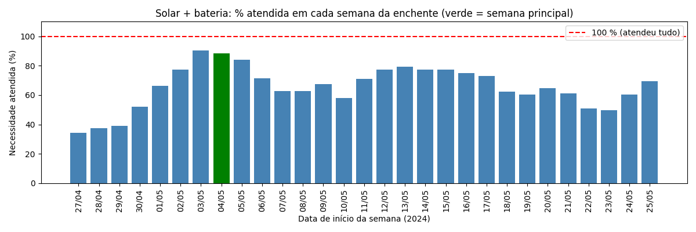

# Citizen Assist AI - Energia na enchente

Global Solution 2026.2 · Soluções em Energias Renováveis e Sustentáveis · 1º ano de Ciência da Computação (FIAP)

| Nome | RM |
|---|---|
| Gabriela Angel Silva | 570808 |
| Izabelly Menezes | 570673 |
| Marcos Paulo Sampaio | 573987 |

Vídeo de demonstração: 

## Público e problema

Na enchente de maio de 2024, muitas casas de Porto Alegre ficaram vários dias sem luz. Escolhemos como público uma casa onde mora uma pessoa que usa concentrador de oxigênio (precisa de energia 24 h) e que guarda insulina na geladeira. A pergunta do trabalho foi: como manter só os aparelhos essenciais funcionando por 7 dias sem luz, e o que é melhor para isso, um gerador a gasolina ou um sistema solar com bateria?

## O que o projeto faz

- `analise_energia.ipynb`: calcula o consumo e a demanda da casa, usa dados reais de sol do INMET (estação de Porto Alegre, 2024), estima o consumo do gerador com regressão linear, dimensiona o sistema solar e simula os 7 dias com o sol de cada dia. No final compara as duas alternativas e escreve a recomendação.
- `assistente.py`: assistente de terminal que usa os resultados do notebook para orientar a pessoa (segurança elétrica na enchente, consumo dos aparelhos, gerador, energia solar, comparação, cálculo de um aparelho e perguntas livres). Toda resposta mostra as fontes e avisa que os valores são estimativas.

## Principais resultados

Consumo só dos aparelhos essenciais: 8,86 kWh por dia (desligar TV e chuveiro economiza 25%). Com o chuveiro a demanda chega a 5,97 kW, mais do que o gerador de 2,5 kW aguenta.

| 7 dias sem luz | Gerador a gasolina | Solar + bateria |
|---|---|---|
| Investimento (estimado) | R$ 3.000,00 | R$ 42.402,00 |
| Custo nos 7 dias | R$ 419,36 (66,6 L) | R$ 0,00 |
| CO2 no uso | 107,8 kg | 0 kg |
| Necessidade atendida (semana de 04/05) | 100%, se houver gasolina | 88,3% |
| Pior semana da enchente (27/04) | 100%, se houver gasolina | 34,4% |

Pelos dados do INMET, maio de 2024 teve 52,4% menos sol que a média do ano. Testando todas as semanas entre 27/04 e 25/05, o solar com bateria atendeu de 34,4% a 90,4% da necessidade, porque vários dias seguidos de chuva esvaziam uma bateria de 1 dia.



## Recomendação

Como a pessoa depende de oxigênio, não dá para contar só com o solar. Recomendamos um sistema híbrido: solar com bateria e um gerador de reserva, sempre fora de casa, só para os dias de pouco sol. Na pior semana o gerador de reserva gastaria cerca de 43,7 L, contra 66,6 L usando só o gerador. Em qualquer caso é preciso ter cilindro de oxigênio de reserva e nunca ligar o chuveiro no gerador. Se não houver dinheiro para o solar, o gerador sozinho resolve, desde que haja gasolina guardada com segurança. O solar se pagaria em cerca de 12 anos com a economia na conta de luz.

## Como rodar

```bash
pip install -r requirements.txt
```

1. Abra `analise_energia.ipynb` no Jupyter ou no VS Code e rode todas as células. O CSV do INMET já está em `dados/inmet/`.
2. Depois rode o assistente:

```bash
python assistente.py
```

## Dados, cálculos e testes

- `dados/aparelhos.csv`: potência e horas de uso de cada aparelho, com a fonte de cada valor.
- `dados/inmet/`: dados horários de 2024 da estação Porto Alegre (A801), baixados do portal do INMET sem edição.
- `dados/gerador_manual.csv`: consumo do gerador por carga. Esses valores são um exemplo, não de um gerador específico.
- `resultados/`: gráficos e o `resultados.json` gerados pelo notebook.
- [REFERENCIAS.md](REFERENCIAS.md): fontes de todos os valores usados.
- [testes_usuarios.md](testes_usuarios.md): testes, problemas encontrados e ajustes feitos no assistente.

## Limitações

As potências dos aparelhos e os preços são estimados, os dados do gerador são de exemplo e usamos uma única estação do INMET. Na simulação solar usamos um rendimento fixo de 0,75, a bateria começa cheia e o resultado muda bastante conforme a semana escolhida. No CO2 do solar contamos só o uso, não a fabricação, e a economia anual não considera as regras da Lei 14.300/2022. É um projeto acadêmico, não substitui orientação médica nem da Defesa Civil.
